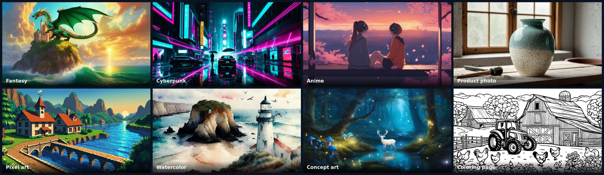

  

  
  

## Hi, I'm Joe

Army veteran, former power engineer, and a long-time hobby programmer. These days I build tools that make life easier for regular people, and I give them away.

**Everything here is free and open source, and it stays that way.** No accounts, no tracking, no "pro" tier. My profit is knowing it helped somebody.

> GIJoe was taken, so I knighted myself.

## What I'm building

### 🤖 [Joe](https://github.com/sirgijoe/joe-ai) &nbsp;`01000001 01001001`

*Humans can't say that, so we just call him Joe.*

An AI helper that runs on **your own PC**. Type what you want in plain words, go to bed, and read the report in the morning. Built for people who have never touched AI, not just programmers.

- **Overnight work**: documents, spreadsheets, pictures, short videos, all queued up and done while you sleep
- **Joe-AiGent, the agent**: hand him a whole job in your own words. He makes a plan, works through it step by step, checks his own work and leaves a report. Any code he writes runs only in a sealed box, and only after you say yes
- **58 ready-made tools**: transcribe, read aloud, proofread, restore old photos, translate, PDF toolkit, privacy blur, meeting minutes, make shorts from a long video and more
- **Pictures, video and sound**: 21 picture styles through ComfyUI, short video clips, music and sound effects, even a picture turned into a 3D model
- **Talk to him**: voice chat with an animated Joe who talks back, plus an optional "Hey Joe" wake word
- **Works with bigger AIs**: an MCP connector for Claude Desktop, ChatGPT desktop, Gemini CLI, Cursor and LM Studio, so the cloud model plans and your PC does the grunt work for free
- Windows, Mac and Linux · GPL-3.0

   
  Every picture here was made by Joe on my own PC. No cloud, no subscription.

### 🛡️ [Squire: Knick Knack Sack](https://github.com/sirgijoe/squire-sack)

*Keeper of your armor, shield, sword, and all your knick knacks.*

A free inventory and collection manager. It started as a way for my wife to catalog her pottery molds, and grew into something anyone can use for cards, coins, books, dolls, or whatever you collect.

- 12 built-in templates plus a builder for your own
- Photos, value history, QR shelf labels, CSV import
- Exports straight to WooCommerce, spreadsheets and printable lists
- Phone-to-desktop sync over your own Wi-Fi. No cloud, no account
- Windows, Mac, Linux, Android and any browser · GPL-3.0

### 🎮 The sirgijoe arcade

Free browser games starring Joe-AI, for PC and phone. Both are being rebuilt right now, so links come back when they're ready.

| Game | What it is |
|---|---|
| **Joe-AI: Escape the Box** | A SNES-style story RPG set inside a computer. Towns, dungeons, rival AIs, and one help-desk program trying to get home. |
| **Joe-AI: The Ascend** | Idle meets tower defense. Run the floor, hire agents, hold the line against competitor AIs, climb to floor 100. |

## In the workshop

- **Hooah** (`hua`): a small, strict programming language designed so AI models can write it correctly, it costs fewer tokens, and people who aren't programmers can still read it. Pre-release.
- **Joe-AI: Total Singularity**: a bigger game for PC and consoles. More when it's ready.

## How this gets built

Three of us work on this: **me**, **Claude**, and **Joe himself**, who drafts parts of his own docs overnight. I plan, test everything on my own PC the way a first-time user would, and nothing ships until it works for people who barely use a search engine.

## What I believe

- Free software should stay free
- Be upfront: say what a thing does, what it touches, and what could go wrong
- If someone who barely uses a search engine can't use it, it isn't done
- Time > money, any day

  Found a bug or have an idea? Open an issue on the project. 
  <a href="https://sirgijoe.com">sirgijoe.com</a>

